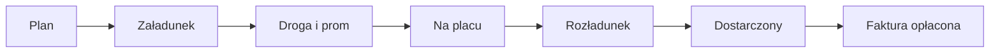

# Trzy opisy pracy firm — stan dzisiejszy

Data: 2026-10-04 (Europa/Warszawa). To opis, nie automat i nie trzy ścieżki w kodzie.

Jedna droga w kodzie, trzy widoki. Firma widzi inny zestaw ekranów i inne pieniądze (`LOGIKA_SYSTEMU.md` §13, `src/lib/permissions.ts`). Dwunastu reguł z podglądu (osobne „workflow” firm) nie ma na produkcji — są wyłączone.

Gdzie źródła się kłóciły, wygrywa polecenie właściciela z 2026-10-04 20:52 w `POLECENIA_KOORDYNATORA.md`. Starsze zdania zostają w historii.

Źródła: `LOGIKA_SYSTEMU.md` §13 i §10, `STATUSY_AUTOMATYCZNE.md`, macierz widoczności w `ZLECENIE_DECYZJE_POWIADOMIENIA.md` §2 i §4, `ZLECENIE_PO_SPOTKANIU_SCX.md` §0 i §2.

## Jedna droga

Korytarz: Śrem → Gdańsk → prom → Nynäshamn → droga w Szwecji → Boden.

Do czasu telematyki statusy, w tym załadunek i rozładunek, ustawiają ręcznie dyspozytor przewoźnika i HHL (przycisk i dziennik, `ZLECENIE_PO_SPOTKANIU_SCX.md` §2). Gdy są pozycje, strefy zmieniają status same. Kierowca nic nie ustawia (D-38, D-79). Aplikacja kierowcy jest ukryta.

## Trzy momenty, nie trzy wersje zamknięcia

To nie są trzy końce do wyboru. Każdy znaczy co innego.

| Moment | Co to jest | Kto |
| --- | --- | --- |
| Rozładunek (UNLOADED) | Data realizacji usługi: faktura, kurs NBP, opłata paliwowa (W5). Wyjazd ze strefy placu, gdy jest telematyka. Bez niej — potwierdzenie dyspozytora (§2). | Dyspozytor przewoźnika albo HHL, ręcznie, dopóki nie ma telematyki |
| Dostarczony (DELIVERED) | Zamknięcie transportu. HHL po komplecie dokumentów. Komplet to samo CMR. Wgrywa je dyspozytor przewoźnika albo HHL (§0). | Tylko HHL |
| Faktura opłacona | Status finansowy, nie status transportu (Q-6, `LOGIKA_SYSTEMU.md` §10). | Tylko HHL |

Obecność na placu to „na placu”, nie rozładunek. Rozładunek jest późniejszy: wyjazd ze strefy albo potwierdzenie dyspozytora.

Starszy zapis „rozładunek nigdy automatycznie” oraz „UNLOADED ustawia kierowca w aplikacji albo HHL” (`STATUSY_AUTOMATYCZNE.md` §2 zasada 3 i §3.3) zostaje w tamtym pliku jako historia. Od 2026-10-04 20:52 go nie stosujemy: z telematyką wyjazd ze strefy placu jest rozładunkiem, bez niej potwierdza dyspozytor, kierowca nie klika.

## HHL

Stan dzisiejszy.

- Zaproszenie i konta. Logowanie hasłem (`ZLECENIE_PO_SPOTKANIU_SCX.md` §1).
- Ekrany: kokpit, mapa, harmonogram, ryzyka, dokumenty, finanse, faktury, strefy, opcje. Administrator widzi też automatyzacje.
- Import harmonogramu: tylko HHL (I-2a). KSH i przewoźnik go nie mają.
- Widzi koszt, przychód i marżę. Oznacza fakturę jako opłaconą i może to cofnąć z powodem.
- Ustawia statusy razem z dyspozytorem przewoźnika, dopóki nie ma telematyki. Zamyka transport (DELIVERED) po CMR.
- Widzi decyzje. Rozstrzyga typy, przy których katalog mówi „HHL”, oraz — jako administrator — każdy typ (L-2).
- Numer zlecenia HHL dodaje i edytuje samodzielnie (§4a).

Planowane, jeszcze nie to, co robi produkcja:

- docelowo harmonogram z SharePoint (D-12, D-SP). Dziś jest import pliku przez HHL, nie odczyt witryny.
- zapis zwrotny do pliku KSH (kierowca, telefon, numery, rejestracja) jest w planie (D-33, II-10-E2), nie w codziennej pracy.

## KSH

Stan dzisiejszy. KSH nic w transporcie nie zmienia (`STATUSY_AUTOMATYCZNE.md` §7).

- Logowanie z zaproszenia HHL.
- Ekrany: kokpit, mapa, harmonogram, ryzyka, dokumenty, rozliczenia, faktury, ustawienia. Nie ma stref, opcji ani automatyzacji.
- Widzi swoją cenę. Nie widzi stawki przewoźnika ani marży.
- Nie importuje harmonogramu.
- Nie oznacza płatności. Może sprawdzić fakturę przychodową: zgodna, sporna (z uzasadnieniem), zaakceptowana.
- Na ryzykach nie widzi pozycji operacyjnych, które nie są jego. Kafelek „Wymaga decyzji” liczy tylko te ryzyka i otwiera Ryzyka, nie Centrum decyzji.
- Listy decyzji nie widzi. Żadnej z 16 decyzji nie rozstrzyga. W katalogu (`ZLECENIE_DECYZJE_POWIADOMIENIA.md` §2) decyduje przewoźnik, HHL albo administrator. Zapis macierzy „KSH, gdy decyduje” nie dodaje KSH żadnego z tych 16 typów. Próba rozstrzygnięcia dostaje odmowę z bazy (L-2).

Planowane, oznaczone wprost, nie jest dzisiejszą pracą:

- planowane: KSH edytuje daty i godziny załadunku i rozładunku (B-KSH).
- docelowo harmonogram z SharePoint (D-12, D-SP). Dziś daty w pliku wgrywa HHL.

## Scandinavian Express

Stan dzisiejszy.

- Logowanie z zaproszenia HHL.
- Ekrany: kokpit, mapa, harmonogram, ryzyka, dokumenty, moje stawki, faktury, moje zadania, ustawienia. Nie ma stref ani opcji.
- Widzi swój koszt. Nie widzi ceny klienta ani marży. Nie oznacza faktury jako opłaconej.
- Uzupełnia awizację swoich transportów: kierowca, ciągnik, naczepa, własny numer zlecenia, rejs (§4). Okien planowych załadunku i dostawy nie zmienia — plan jest z harmonogramu.
- Do czasu telematyki ustawia statusy, w tym załadunek i rozładunek, przyciskiem. Zapis idzie do dziennika. Z pozycjami strefy robią to same.
- Wgrywa CMR. Po komplecie HHL zamyka transport.
- Rozstrzyga typy, przy których katalog mówi „przewoźnik” (między innymi rejs, późna zmiana daty KSH, brak awizacji, brak pozycji, zjazd, polisa).

Kierowca nie ma tu kroku. Starsza instrukcja przewoźnika, która każe kierowcy klikać etapy i wgrywać zdjęcia, jest sprzeczna z D-38 i D-79 oraz z §0 zlecenia po spotkaniu. Obowiązuje: kierowca nic.

## Czego ten plik nie robi

Nie dodaje automatu, nie zmienia statusów w bazie i nie czyści danych. R-0 zostaje planem do akceptacji: kasowane wyłącznie transporty i wiersze z nimi związane, reszta zostaje, wykonanie dopiero tuż przed R-1. Status R-1 bez zmiany.
