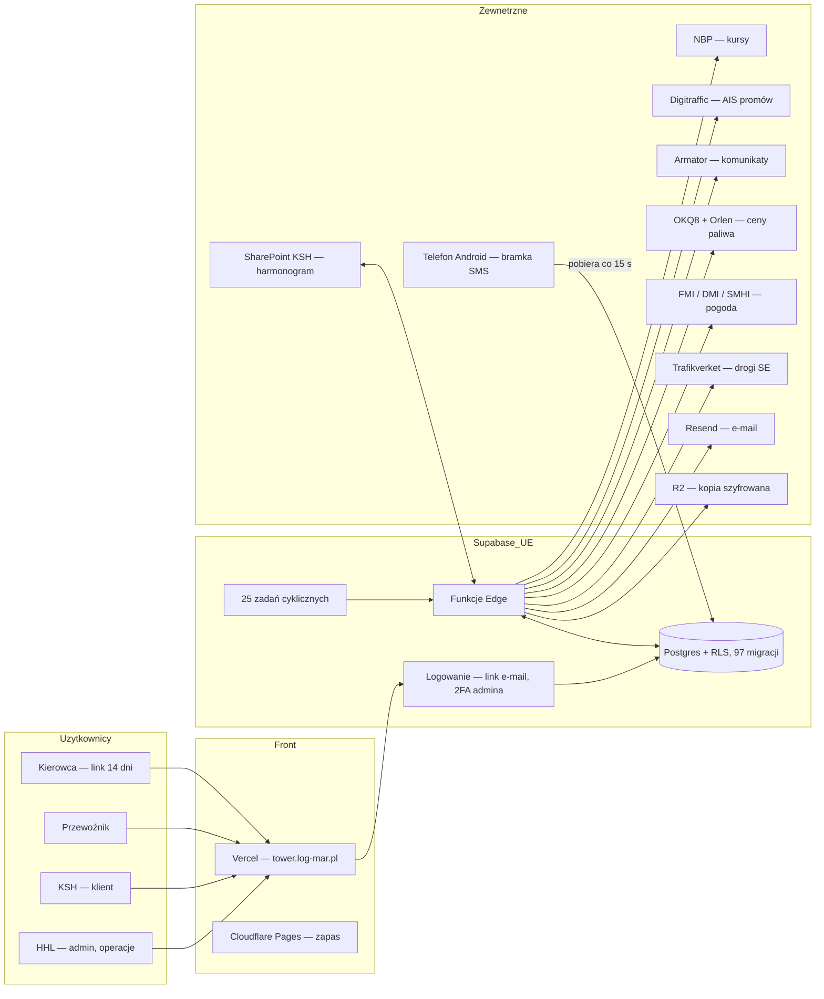
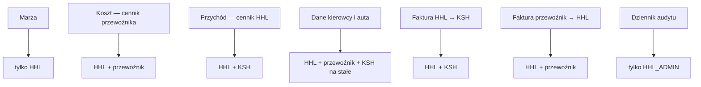
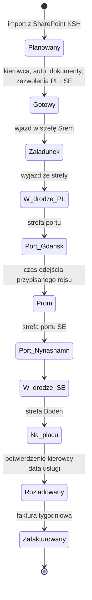
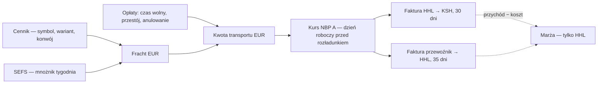
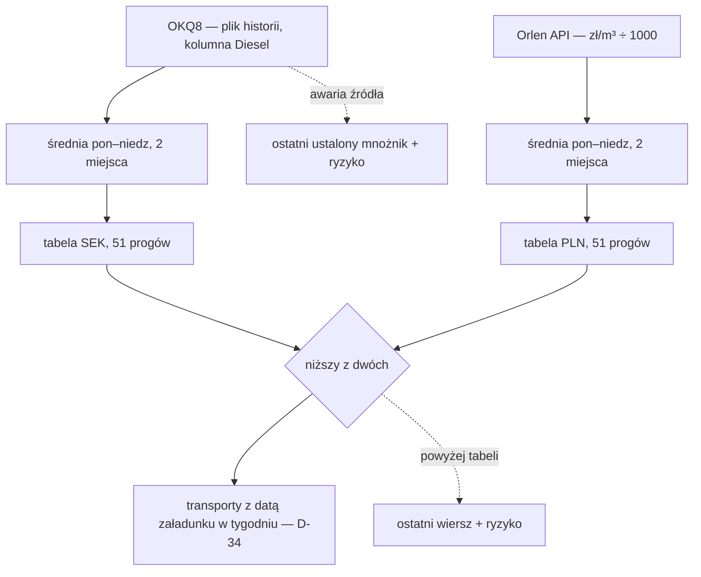
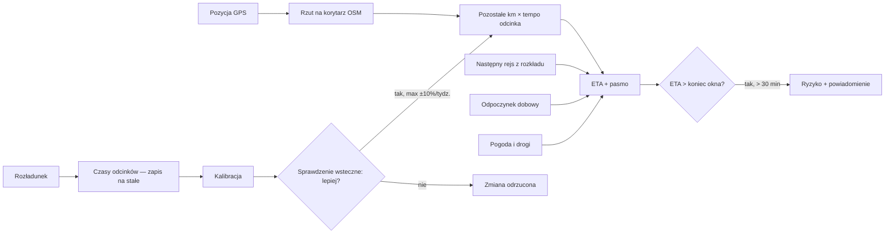
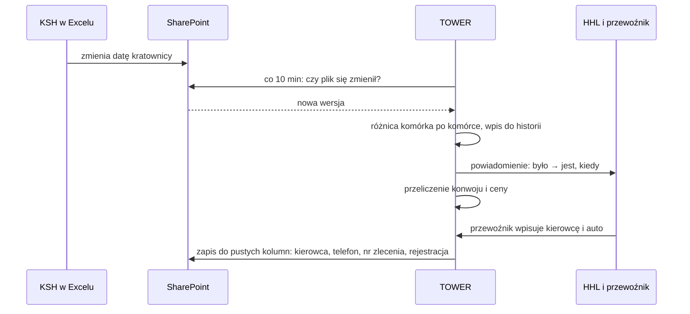
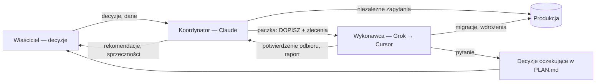
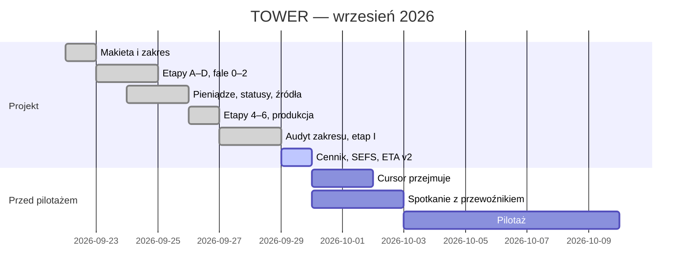

# WIZUALIZACJE TOWER

> Diagramy w składni Mermaid — wyświetlają się w GitHub, w Cursorze
> (podgląd Markdown z rozszerzeniem Mermaid) i w pliku `09_WIZUALIZACJE.html`.

## 1. Architektura

## 2. Kto widzi co

## 3. Droga transportu i statusy z GPS

## 4. Przepływ pieniędzy

## 5. Mnożnik paliwowy SEFS

## 6. ETA i kalibracja ucząca się

## 7. SharePoint w obie strony

## 8. Model pracy

## 9. Oś czasu

