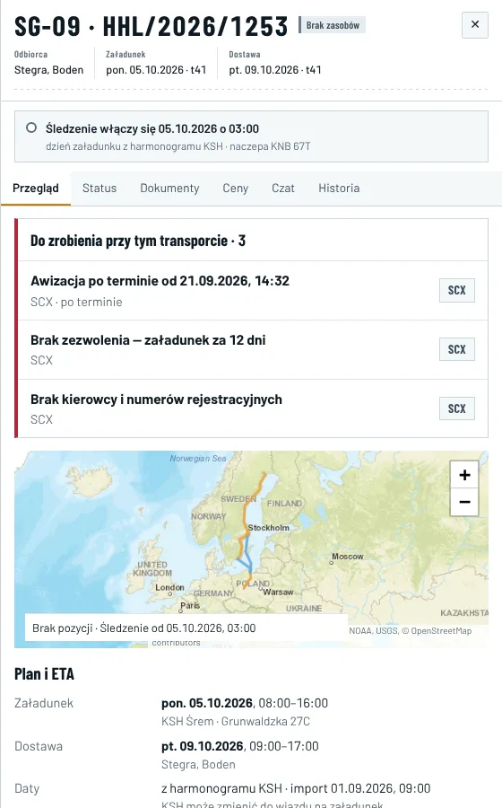
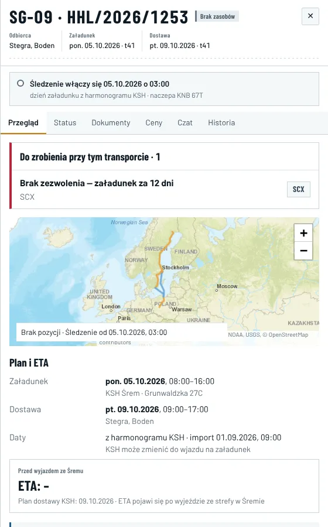
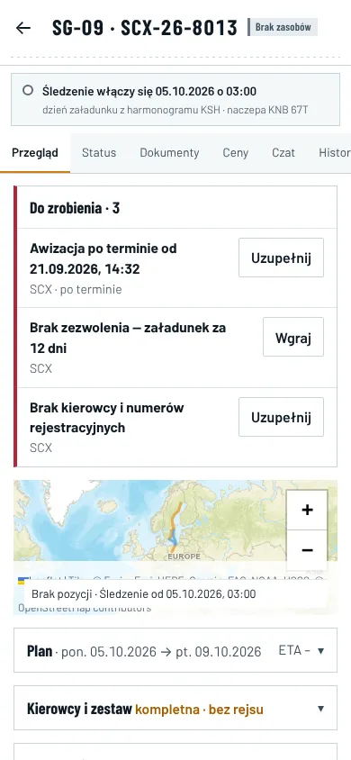
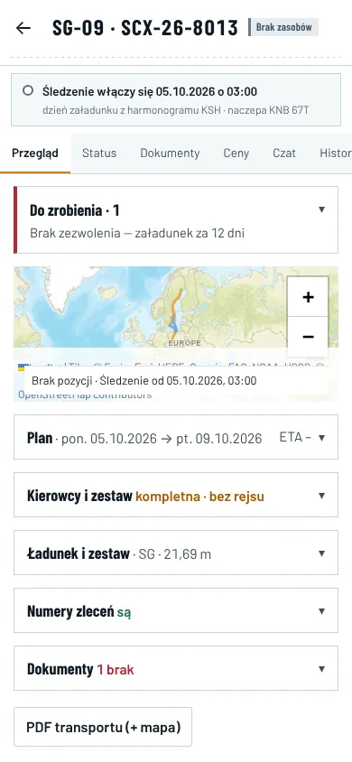
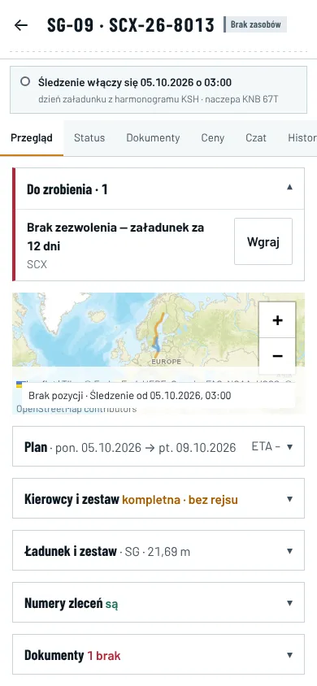
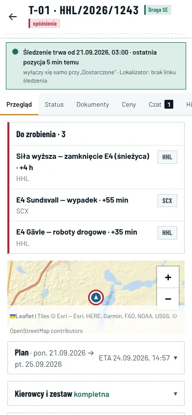
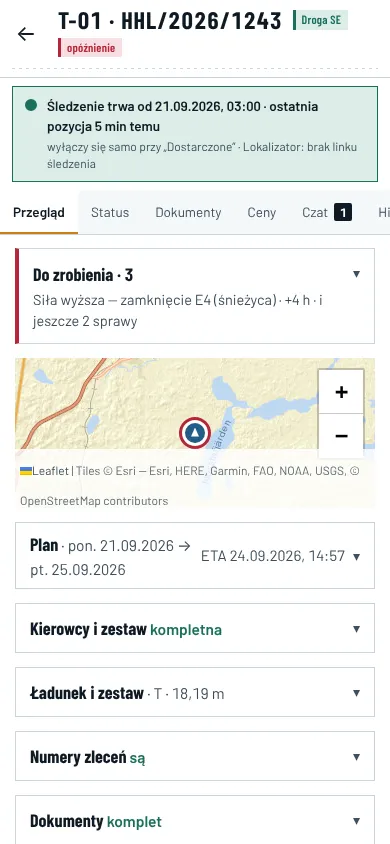
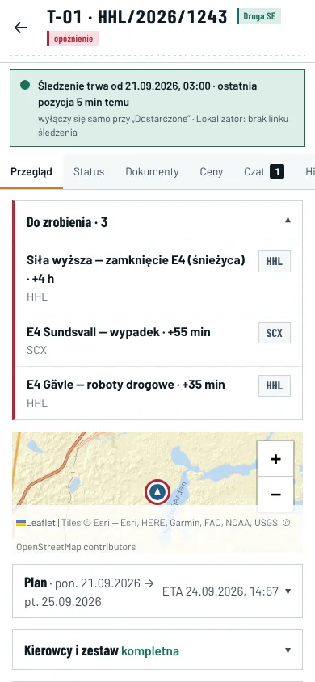
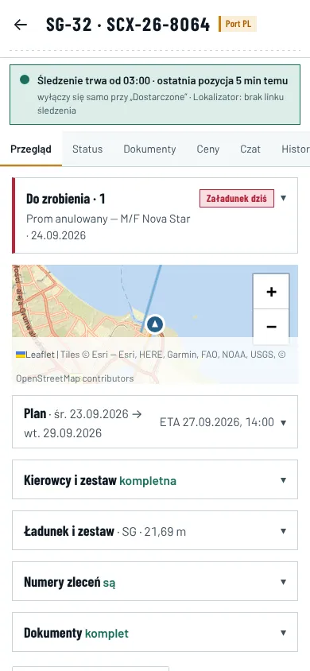
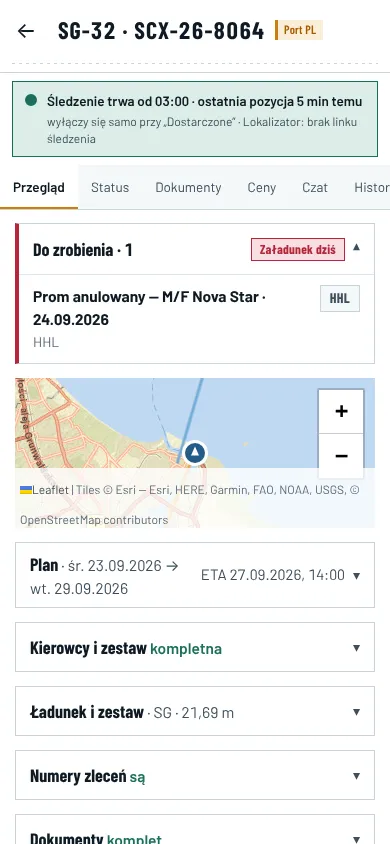

# W-panel-do-zrobienia — panel transportu › Przegląd › „Do zrobienia”

Koordynator (Claude), 18.10.2026, 12:15. Gałąź `wyglad/W-panel-do-zrobienia` (od `main` a51cf77). F8: wygląd i obliczenia widoku, bez bazy.

## Polecenie właściciela

- 18.10, 11:35: „w prawym pasku transportu w harmonogramie, gdy pojawia się sekcja Do zrobienia, to ciągle wyświetla się wszystko. Nawet to, co jest już zrobione. Tak nie powinno być. (…) ta sekcja też powinna być rozwijalna na komórce”.
- 18.10, 11:46: „Zwijalna ma być tylko sekcja Do zrobienia na zakładce Przegląd. Sekcja ta ma pokazywać tylko aktualny stan, a gdy wszystko jest zrobione, ma nie pokazywać rzeczy do zrobienia. Nic innego masz nie zmieniać.”

## Co było (sprawdzone)

**Produkcja** (tylko odczyt, 18.10, 11:40): otwarte sprawy przy transportach, które są już zrobione:

| sprawa | ile | dlaczego nieaktualna |
|---|---|---|
| „Decyzja po terminie: …” (`rk_decision_overdue`) | 16 | decyzja zamknięta („nieaktualna — warunek ustał”), sprawa została otwarta |
| „brak awizacji / tablic” (`rk_res_driver`, `rk_res_vehicle`) | 6 | transport dostarczony albo zafakturowany; dane kierowcy i tablice są wpisane |
| „automat nie zmienił statusu” (`rk_auto_status_blocked`) | 1 | transport dostarczony |

Przyczyny:

- **Baza** nie zamyka sprawy „Decyzja po terminie”, gdy decyzja się zamknie. Nie zamyka też alarmów „przed załadunkiem”, gdy transport jest już dostarczony.
- **Aplikacja** pokazywała sprawy z chwili wczytania strony. Po wpisaniu awizacji albo numeru zlecenia w panelu sprawa zostawała do odświeżenia strony.

**Demo:** SG-09 i SG-18 — sekcja „Kierowcy i zestaw” pokazuje „kompletna”, a „Do zrobienia” nadal „Brak kierowcy i numerów rejestracyjnych” i „Awizacja po terminie”.

## Co zmienia ta gałąź (tylko sekcja „Do zrobienia” w zakładce Przegląd)

1. **Tylko aktualny stan.** Sprawa znika z sekcji, gdy dane transportu pokazują, że jest zrobiona:
   - **„Brak awizacji”:** kierowca, telefon, ciągnik i naczepa są wpisane. To ta sama zasada co w bazie (0143 `l3_*`).
   - **„Brak tablic”:** ciągnik i naczepa są wpisane.
   - **„Brak numeru zlecenia HHL / przewoźnika”:** numer jest wpisany.
   - **Demo „Brak kierowcy i numerów rejestracyjnych”:** kierowca, ciągnik i naczepa są wpisane.
   - **„Brak awizacji” (decyzja demo):** awizacja jest kompletna, tak jak w sekcji „Kierowcy i zestaw”.
   - **„Brak zezwolenia” / „niezgodne z zestawem”:** sekcja „Dokumenty” pokazuje zezwolenie „jest”. Przy braku dokumentu z bazy (`rk_res_docs`) potrzebna jest też polisa przewoźnika.
   - **Alarmy przed załadunkiem i w drodze:** transport jest dostarczony, zafakturowany albo anulowany.

   Gdy nic nie zostaje, sekcji nie ma. Zasada jest w `src/lib/todoRules.ts` (`todoDoneOnLoad`, `openTodoRisks`), a filtr zezwoleń w `PanelOverview.tsx`.
2. **Telefon:** sekcja „Do zrobienia” zwija się i jest domyślnie zwinięta.
   - Nagłówek ma liczbę spraw, pod nim pierwszą sprawę i „i jeszcze N sprawy”.
   - Pasek po lewej (bursztyn albo czerwień) i „Załadunek dziś” zostają.
   - Po rozwinięciu widać listę spraw, a linia stanu znika.
   - Wysokość nagłówka to co najmniej 44 px.
3. **Bez zmian:**
   - komputer: sekcja otwarta, nagłówek „Do zrobienia przy tym transporcie · N”;
   - pozostałe sekcje Przeglądu;
   - zakładki Status, Dokumenty, Ceny, Czat, Historia;
   - strona Ryzyka, Kokpit i liczby w menu (polecenie 11:46);
   - baza i dane.

## Zrzuty (demo, zegar 23.09.2026 16:32)

| | przed (main) | po (gałąź) |
|---|---|---|
| HHL, SG-09, komputer 1440 |  3 sprawy, w tym 2 zrobione |  1 sprawa — brak zezwolenia |
| SCX, SG-09, telefon 390 |  |  zwinięte ·  rozwinięte |
| HHL, T-01, telefon 390 (3 sprawy) |  |  „i jeszcze 2 sprawy” ·  |
| SCX, SG-32, telefon 390 (załadunek dziś) | — |  ·  |

Wzorzec E32 (`raport/img/e32-after.webp`, „Telefon: Do zrobienia na górze, sekcje zwinięte z linią stanu”): „Do zrobienia” zostaje na górze, nad mapą. Teraz zwija się tak samo jak sekcje pod mapą (decyzja właściciela 18.10, 11:46 wygrywa).

## Testy (lokalnie, build gałęzi)

- **Unit:** cały zestaw zielony; nowy `tests/panel-todo-done.test.ts` (6) obejmuje zasady zrobione/niezrobione, po dostawie i to, co zostaje.
- **e2e:**
  - nowy opis w `etap6-ui` („Panel › Przegląd › Do zrobienia — aktualny stan…”, 2 testy) — na `main` pada, na gałęzi przechodzi;
  - etap4, etap5 i etap6 — 30 z 30;
  - e8-phone-gate (P7-a Przegląd, P6 Ryzyka, P9-f) — 11 z 11.
- **visual:** te same 2 różnice co na `main` lokalnie (Kokpit 1920, fokus/najechanie w ciemnym motywie — czcionki środowiska); w CI rozstrzyga check `visual`.

## Czego ta gałąź nie zamknie (baza — dopisek do wykonawcy)

16 spraw „Decyzja po terminie” przy zamkniętych decyzjach widać w panelu, dopóki baza ich nie zamknie. Aplikacja nie ma pewnej listy zamkniętych decyzji: otwartych jest 52, a lista w aplikacji ma limit 50. Zamknięcie tych spraw i porządek w starych wpisach to zadanie bazy: D-20261018-1215-01.
